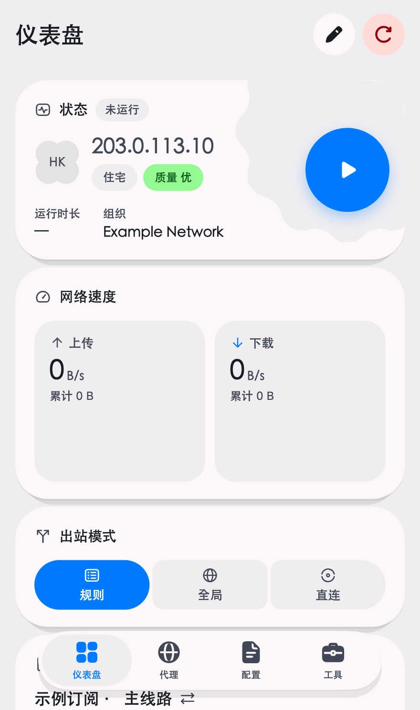
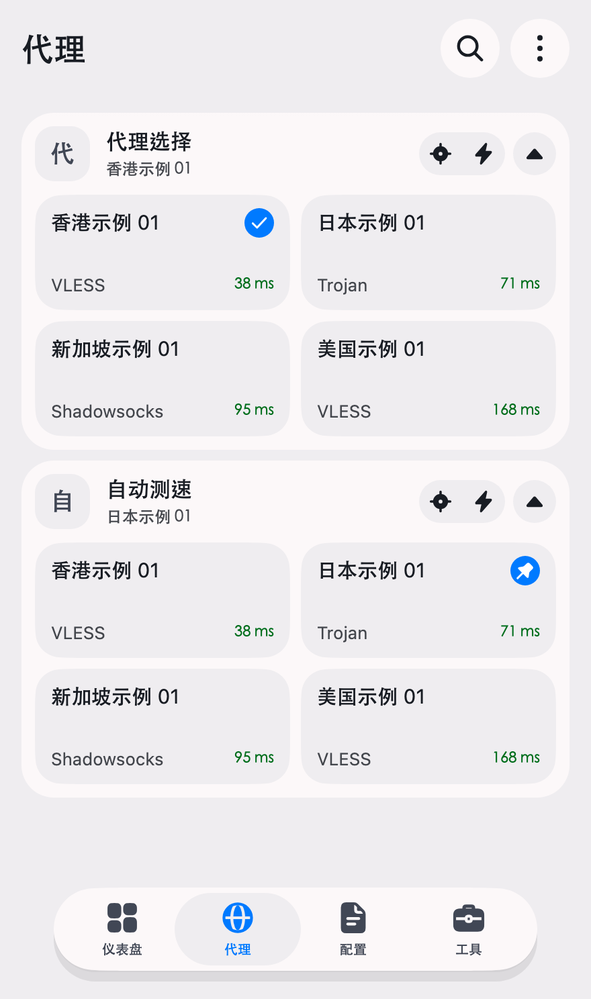
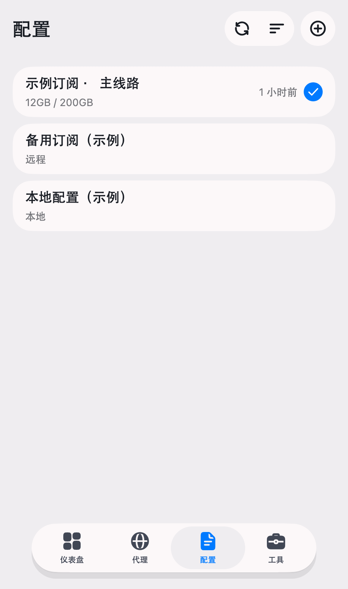
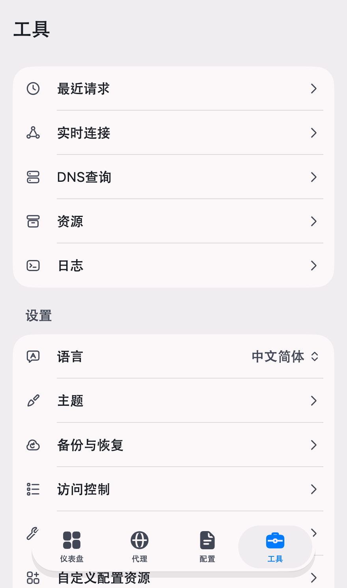

# FlClash v0.9.2 鸿蒙界面预览

本次预览直接渲染官方 FlClash v0.9.2（上游 `7fd417fb`）的 `HomePage`、`DashboardView`、`ProxiesView`、`ProfilesView` 和 `ToolsView`。没有使用旧版自定义首页，也没有用 AI 绘图或另写示意界面。

## 渲染条件

- Flutter OHOS `3.47.7+ohos-0.0.1-pre`，Dart `3.13.5`。
- Pura X View 截图对应的逻辑尺寸：440 × 744；PNG 输出为 880 × 1488（2 倍像素）。
- 最新界面的浅色主题、简体中文、默认浮动导航。保留原版卡片、图标、四页导航与布局。
- 主题平台设为 `TargetPlatform.ohos`，首页使用独立 `SupportPlatform.HarmonyOS`，工具页使用移动平台参数。宿主仍是 macOS，未将 `dart:io` 的实际系统伪造成鸿蒙。
- 为避免 Flutter 测试字体 Ahem，临时载入宿主 SFNS / STHeiti 字体，并为 Roboto 注册中文字体。字形不是目标手机 HarmonyOS 系统字体的精确复刻。
- 每页用独立 Flutter test 进程渲染，截图与 PNG 编码置于 `tester.runAsync`；完成后再复制到此目录，避免测试引擎图层复用及读取正在写入的图片。

## 示例数据

所有配置名、节点和延迟均为测试假数据。订阅只使用 `example.com` / `example.org`，出口地址为文档保留地址 `203.0.113.10`。住宅类型、质量、流量和节点延迟也由测试提供，不是实测结果。截图没有加载真实订阅、账号或凭证。

- 首页：原版状态与启动按钮、网络速度、规则/全局/直连选择和配置卡片；状态为“未运行”。
- 代理：手动选择与自动测速两个示例分组，显示四个示例节点及模拟延迟。
- 配置：两个远程示例订阅和一个本地示例配置。
- 工具：最近请求、实时连接、DNS 查询、资源、日志、语言、主题、备份与恢复、访问控制等原版入口。日志入口通过现有设置启用。

## 验证

- UI 定向测试 136 项通过：应用访问控制、网络设置、工具移动入口、扫码生命周期、文件读取、滚动、首页布局和导航。
- `file_picker_ohos` 的 5 项通道协议测试通过：真实旧 OHOS map 结构、缓存文件字节/流读取、选择取消、保存文档 URI、空文件分发、保存取消。
- `file_picker_ohos` Dart 分析无问题；Code Forge 两处移动交互平台判断的定向 Dart 分析无问题。
- 四页独立渲染的视图断言通过；PNG 尺寸及实际像素图经检查。
- 本次没有运行客户端 build、打包或安装。这是 Flutter widget 测试预览，尚不能替代新客户端的真机 VPN、系统选择器、权限、扫码摄像头与折叠屏实测。

临时渲染脚本：`/tmp/xiaomao-latest-mobile-preview_test.dart`。定向测试日志：`/tmp/xiaomao-latest-ui-tests-final.log`。独立预览日志：`/tmp/xiaomao-latest-preview-{dashboard,proxies,profiles,tools}-isolated.log`。脚本未加入长期测试或 golden 基线。

## 图片

## 官方 Logo 与“小猫代理”名称

按用户要求保留官方 FlClash v0.9.2 原 Logo，仅保留“小猫代理”的显示名称。

- 上游来源固定为 `7fd417fb9a9a277c6a9339a8ac87f907df7c25f7`。
- `assets/images/icon.png` 和鸿蒙启动窗口 `ohos/entry/src/main/resources/base/media/icon.png` 逐字节复用上游 PNG；SHA-256 为 `15ff524fa1fb92168b692797d842870b16b7974619c5829d624902a3a6a2bc46`。
- 鸿蒙桌面沿用 `layered_image.json` 的前景/背景分层。前景 `foreground.svg` 机械转换上游 `android/.../ic_launcher_foreground.xml`，保持其三条路径、三组渐变和两级安全区变换；背景 `background.svg` 复用上游 `ic_launcher_background.xml` 的 `#F7F9FB`。没有重新设计或使用 AI 绘图。
- 删除旧猫图标的 `app_icon*.svg`、旧 PNG 图层和 `generate_app_icon.dart`，恢复最新版官方 `assets_source/images/icon/` 五份源 SVG，避免后续生成覆盖回旧样式。
- 已核对 AppScope、EntryAbility、TempAbility 图标引用，确认前景/背景各只有一个同名资源；应用显示名及桌面标签仍为“小猫代理”。
- 验证包括 PNG 原始字节比对、矢量路径/渐变属性比对、SVG 解析渲染、资源引用和名称检查。此图标调整未执行客户端构建、打包或安装；系统资源编译和真机桌面显示在授权打包后验证。
